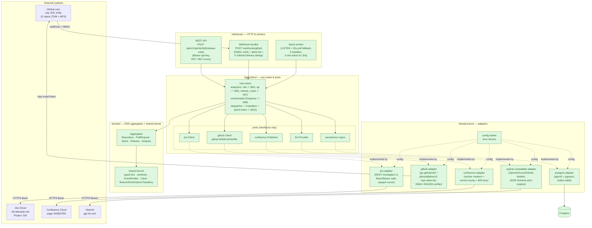

# RepoMind — Architecture

> Living document. Updated at the end of every module. Source of truth
> for **what is built**, **what is pending**, and **why the structure
> is shaped the way it is**.

**Last updated:** 2026-07-10 — Per-sprint Confluence pages +
auto-materialise on activation. The Confluence publisher can now
create one child page per sprint (named `Sprint-<n>`) under a
named parent folder instead of overwriting a single master page.
The sprint ticker also fires a `release_notes.requested` event on
EVERY tick while a sprint is active (not only on close), so a
sprint page appears within one tick of the sprint going active on
Jira. Adds migration `000007_sprint_page` (mapping table
`sprint_id UUID PK → page_id TEXT`), `Confluence.CreatePage`,
`SprintPageResolver`, and two new env vars
(`REPOMIND_CONFLUENCE_PARENT_ID`, `REPOMIND_CONFLUENCE_SPACE_KEY`).
When those two vars are empty the old single-page mode is
preserved bit-for-bit. See §M8 → "Per-sprint pages (M11)" and
§M10 → "Ticker semantics".

**Prior update:** 2026-07-09 — Post-M10 hotfix: ticket-key extraction
from PR metadata (title / body / head branch / commit messages) is
now performed in `applyGitHubUpdate` so every ingested PR is stored
with its Jira keys populated. Without this fix,
`PullRequests.ListByTickets` (the ticket → PR join used by
release-notes rendering) always returned empty and the Confluence PR
column stayed blank forever. See §8 → "Ticket-key extraction fix".

**Prior update:** 2026-06-29 — Module 10 (sprint worker: dispatcher + ticker + 3 handlers + 6-layer dedup)
delivered. Adds the `internal/interfaces/http/` layer, the durable
orchestration enqueuer, and the `outbox.dedup_key` + `pg_notify`
pipeline that M10's dispatcher will consume.

---

## 1. Goal

Generate sprint release notes for the **Marvelous** sub-team on Jira
board 187 by combining:

- **Jira** — sprint and ticket data (source of truth for sprint scope)
- **GitHub** — pull requests, files, commits, reviews across 12 repos
  under the `SHL-India` org (TDM × 7 + MFS × 5)
- **OpenAI** — analysis / summarisation
- **Confluence** — published output on page `345833780`
  ("Release Notes Generator", space `SHL360`)

V1 is single-team. V2 will fan out to the other Marvels sub-teams
(Kang / IronMan / Gladiators), each with its own sprint prefix and its
own Confluence page — see §6.

---

## 2. Layered architecture

> Quick visual overview lives in **[diagrams/](diagrams/)** — layered architecture, end-to-end webhook → Confluence sequence, and outbox state machine. The diagram below is the same architecture view rendered larger for editing.

Dependencies point inward. The domain has zero outward imports.



---

## 3. Rules the picture encodes

| Rule | Meaning |
|---|---|
| Dependencies point inward | `interfaces` → `application` → `domain`. `infrastructure` only *implements* application ports; it never calls use-cases. |
| Domain has zero outward imports | No `net/http`, no `database/sql`, no SDKs in `internal/domain`. |
| Ports, not structs | Use-cases hold `jira.Client` (interface), not `*jira.Client`. Swap REST→GraphQL by replacing one file. |
| Defence in depth | GitHub: read-only App perms **and** `Config.Repos` allow-list. Webhooks: HMAC-SHA256 constant-time compare, sha1 explicitly rejected. |
| Opaque cursors | Pagination cursors are opaque strings at the port boundary. Today they're page numbers; tomorrow they could be GraphQL `endCursor`s — callers don't change. |
| Fan-out-ready, not fanned out | V1 = one team, one Confluence page. V2 = list of `(team, sprintPrefix, confluencePageId)` triples. No other layer changes. |
| YAGNI by default | No agent registry, no plugin system, no multi-tenant story until there's a real second tenant. |

---

## 4. Module status

| # | Module | Status | Path / key files |
|---|---|---|---|
| 0a | Scaffolding | ✅ Done | `cmd/repomind/`, `go.mod`, `Makefile`, `configs/`, `migrations/`, `.github/` |
| 0b | Domain layer | ✅ Done | `internal/domain/{repository,pullrequest,sprint,release,analysis,shared}` |
| 1  | Jira integration | ✅ Done | `internal/application/jira/port.go`, `internal/infrastructure/jira/{client,auth,config,dto,errors}.go` + tests |
| 2  | GitHub integration | ✅ Done | `internal/application/github/port.go`, `internal/infrastructure/github/{client,auth,config,dto,errors,webhook}.go` + tests |
| 3  | Postgres persistence | ✅ Done | `internal/infrastructure/postgres/{pool,errors,dbtx,sprints,repos,pullrequests,releases,analyses,outbox,uow}.go` + `internal/application/persistence/{ports,errors,outbox}.go` + `migrations/000002_persistence.up.sql` |
| 4  | OpenAI-compatible LLM adapter | ✅ Done | `internal/application/llm/port.go` + `internal/infrastructure/openai/{config,dto,client,schemas}.go` + `internal/infrastructure/openai/schemas/*.json` |
| 5  | Analyzer #1 — Risk classifier (per PR) | ✅ Done | `internal/application/analysis/risk/{analyzer,prompt,decode}.go` + `analyzer_test.go` |
| 6  | Analyzer #2 — QA recommendations | ✅ Done | `internal/application/analysis/qa/{analyzer,prompt,decode}.go` + `analyzer_test.go` |
| 7  | Analyzer #3 — Release-notes composer | ✅ Done | `internal/application/analysis/releasenotes/{analyzer,prompt,decode}.go` + `analyzer_test.go` |
| 8  | Confluence publisher | ✅ Done | `internal/application/publish/port.go` + `internal/infrastructure/confluence/{client,config,dto,errors,markdown,publisher,section}.go` + `{client,markdown,publisher,section}_test.go` |
| 9  | REST API + webhook handler | ✅ Done | `internal/application/orchestration/{port,enqueuer}.go` + `internal/interfaces/http/{doc,problem,middleware,auth,health,webhook_github,sprints,server}.go` + `server_test.go` + `migrations/000003_dispatch.{up,down}.sql` + outbox extensions in `internal/application/persistence/outbox.go` and `internal/infrastructure/postgres/outbox.go` |
| 10 | Sprint worker (dispatcher + ticker + 3 handlers) | ✅ Done | `internal/application/orchestration/{dispatcher,webhook_handler,pr_analysis_handler,release_notes_handler,ticker}.go` + `_test.go` for each + `migrations/000005_worker_state.{up,down}.sql` + `migrations/000006_release_content_hash.{up,down}.sql` + `internal/application/persistence/worker_state.go` + `internal/infrastructure/postgres/worker_state.go` + extended `Releases` port (`FindLatestBySprint`) + extended `Outbox` port (`MarkPermanentlyFailed`) + `Worker` / `Ticker` config blocks |

---

## 5. Per-module decisions log

### Module 1 — Jira

- REST `/rest/agile/1.0` (Agile API), hand-rolled HTTP client (no SDK).
- Auth: Basic (email + API token) **or** Bearer — single env flag picks
  which. Avichal uses Basic on Cloud.
- Pagination: Jira's `startAt`/`maxResults`, exposed as opaque cursor
  at the port.
- Retries: bounded backoff on 429 / 5xx.

### Module 2 — GitHub

- App authentication via `bradleyfalzon/ghinstallation/v2` — automatic
  installation token renewal.
- REST via `google/go-github/v63`.
- `Config.Repos` allow-list is a second line of defence on top of the
  App's repo permissions; queries to anything else return
  `ErrUnauthorizedRepo` without touching the network.
- Webhook verifier: HMAC-SHA256, constant-time compare. `sha1=`
  prefixes are explicitly rejected (deprecated by GitHub in 2019).
- DTO mappers are nil-safe and clear `Merged` if a merged PR has
  neither `MergeSHA` nor `MergedAt` (rare API edge case).
- Test seam `newClientWithGHClient` lets unit tests bypass App auth
  and point go-github at `httptest`.

### Post-M2 reconciliation pass

- **Config loader gaps closed.** `infrastructure/config/Config` now
  exposes the full Jira (`ProjectKey`, `BoardID`, `TeamName`,
  `SprintNamePrefix`) and GitHub (`Repos`, `Timeout`, `MaxRetries`)
  surface, plus translator helpers `JiraAdapter()` /
  `GitHubAdapter()` consumed at the composition root.
- **Latent bug fixed:** `Config.GitHub` was tagged
  `split_words:"true"`, which made envconfig look for
  `REPOMIND_GIT_HUB_*` (with an underscore). Every GitHub env var was
  being silently ignored. Switched to `envconfig:"GITHUB"` and added
  unit coverage so it can't regress.
- **Secrets discipline:** new `secrets/` folder; `.gitignore` belt-
  and-braces (`secrets/* !secrets/.gitkeep`). The dev GitHub App
  private key goes to `./secrets/repomind-shl-india-dev.2026-06-26.private-key.pem`
  (path matched in `config.dev.env`).
- **Pre-commit secret-scan hook** at `scripts/git-hooks/pre-commit`,
  installed via `make hooks` (sets `core.hooksPath`). Blocks (a)
  staged filenames matching `*.pem`, `*.key`, `*.p12`, `id_rsa*`,
  `credentials.json`, `service-account*.json`, `.env`, etc. — even
  when force-added past `.gitignore`; (b) added content containing
  `-----BEGIN … PRIVATE KEY-----` or token shapes for GitHub
  (`ghp_/ghs_/gho_/github_pat_`), OpenAI (`sk-…`, `sk-proj-…`),
  AWS (`AKIA…`), Atlassian (`ATATT3…`), Slack (`xox[abprs]-…`), and
  GCP (`AIza…`). Bypass requires explicit `git commit --no-verify`.
  `make scan-secrets` dry-runs the same scan.
- **Cleanup:** removed orphan `configs/config.example.yaml` (we are
  env-only). Migration `000001` comment now correctly references
  Module 3 as its replacement.
- **docker-compose** now passes through every `REPOMIND_*` env from
  the host shell and mounts `../secrets:/secrets:ro`.

### Module 3 — Postgres persistence

- **Driver:** `jackc/pgx/v5` + `pgxpool`. No ORM. The repository
  surface is hand-rolled SQL. We trade a tiny bit of repetition for
  full control over query shape, transactional grouping, and the
  ability to read the SQL inline next to the Go code that runs it.
  `sqlc` was considered and rejected as overkill for the current
  query volume (≤ 25 statements).
- **Ports vs. adapters.** `internal/application/persistence` owns the
  port interfaces (`Sprints`, `Repos`, `PullRequests`, `Releases`,
  `Analyses`, `Outbox`), the `Stores` bundle, the `UnitOfWork`
  contract, and the sentinel errors (`ErrNotFound`, `ErrConflict`,
  `ErrSerialization`). `internal/infrastructure/postgres` is the only
  implementation. Application services depend on the ports, never on
  pgx.
- **`dbtx` seam.** Every adapter takes a tiny `dbtx` interface
  (`Exec` / `Query` / `QueryRow`) satisfied by both `*pgxpool.Pool`
  and `pgx.Tx`. This means the *same* repository struct serves both
  pool-bound reads and transaction-bound writes without two parallel
  hierarchies. `NewStores(pool)` wires pool-bound; `UnitOfWork.Within`
  wires tx-bound.
- **Error translation.** `classify(op, err)` is the single funnel.
  It passes context cancel/deadline through, maps `pgx.ErrNoRows` →
  `ErrNotFound`, maps unique/exclusion/FK/check/not-null violations →
  `ErrConflict`, and maps 40001/deadlock → `ErrSerialization`. Above
  the adapter, code only matches on the sentinels.
- **UnitOfWork.** `Within(ctx, fn)` opens a `ReadCommitted` tx,
  builds a tx-bound `Stores`, defers rollback, and commits on
  callback success. A returned error rolls back and bubbles
  unchanged; this is how the rollback test asserts via
  `errors.Is(err, sentinel)`.
- **JSON-in-jsonb for collections.** PR labels, ticket keys, file
  lists, commit lists, reviewer lists, release PR-id lists, outbox
  payloads, and analysis payloads all live in `jsonb` columns rather
  than child tables. Sprint release notes are read-mostly bulk
  rollups — denormalising means **one row, one fetch** per PR, and
  ticket-based lookups still work via a GIN index
  (`pr_tickets_gin USING gin (tickets jsonb_path_ops)`).
- **Polymorphic analysis payload.** `analysis.Payload` is an
  interface marker with three concrete implementations
  (`RiskReport`, `ReleaseNotes`, `QARecommendations`). The schema
  stores them as one `jsonb` column plus a `kind` discriminator.
  Round-trip is done by `analysis.MarshalPayload` /
  `analysis.UnmarshalPayload` *in the domain package* — keeping the
  type switch alongside the `Kind` constants means adding a new kind
  is a single-file change.
- **Append-only analyses.** Unlike sprints/repos/PRs/releases which
  use `INSERT … ON CONFLICT DO UPDATE` for idempotent re-ingestion,
  the `analysis` table has no `ON CONFLICT` clause: each agent run
  produces a new immutable row. Duplicate IDs surface as
  `ErrConflict`, which is the correct response (it would be a
  programmer bug).
- **CHECK constraints over enum types.** Every status / kind column
  uses a `text CHECK (col IN (...))` instead of a Postgres enum type.
  Adding a value is a one-line DDL edit, not an `ALTER TYPE` ritual.
- **FK strategy.** Parent-owned children CASCADE on delete
  (`analysis → pr/sprint/release`, `pr → repo`). Cross-aggregate
  references RESTRICT (`release → sprint`) so a sprint can never be
  silently orphaned underneath an in-flight release.
- **Outbox.** Transactional outbox: producers insert an outbox row
  inside the same `UnitOfWork.Within` block as the aggregate change.
  A future worker (Module 10) polls
  `WHERE status='pending' AND next_attempt_at <= now()` ordered by
  `next_attempt_at`, dispatches, and calls `MarkDispatched` or
  `MarkFailed`. `MarkFailed` increments `attempts`, records
  `last_error`, and reschedules — status stays `pending` so the row
  is picked up again. This gives at-least-once delivery without
  depending on Confluence/webhooks being up at write time.
- **Domain rehydration.** Each aggregate exposes a `Rehydrate(...)`
  constructor used *only* by the persistence adapter. It bypasses
  the validating `New*` path because the data came from the DB,
  which is trusted (validation already ran on the write path, and
  DB constraints enforce the same invariants). Value objects
  (`shared.Branch`, `shared.SHA`, `shared.Author`, `shared.TicketKey`,
  `release.Version`) are reconstructed via their own `New*` so the
  type-level invariants remain intact.
- **Integration tests.** `postgres_integration_test.go` is gated by
  `//go:build integration` and uses `testcontainers-go` v0.43 with
  `postgres:16-alpine`. The standard `go test ./...` skips it; CI /
  local runs with Docker use
  `go test -tags=integration ./internal/infrastructure/postgres/...`.
  Coverage: round-trip per aggregate, outbox enqueue/dispatch
  lifecycle, UoW commit + rollback, polymorphic payload rehydrate,
  `ErrNotFound` mapping.

---

### Module 4 — OpenAI-compatible LLM adapter

- **Port name is provider-neutral.** The application port is
  `llm.Provider` (in `internal/application/llm/port.go`), not
  `OpenAI`. The whole layer above never references a vendor. Sentinel
  errors are vendor-neutral too: `ErrRateLimited`, `ErrModelUnavailable`,
  `ErrUnauthorized`, `ErrInvalidResponse`, `ErrContentFiltered`.
- **One adapter, three deployments.** OpenAI, Azure OpenAI, and
  GitHub Models all speak the same Chat Completions wire protocol.
  A single `Deployment` enum (`openai` / `github_models` /
  `azure_openai`) toggles the two differences that matter:
  - **Auth header**: Azure uses `api-key: <key>`; OpenAI and GitHub
    Models use `Authorization: Bearer <key>`.
  - **URL shape**: Azure appends `?api-version=2024-10-21` (default,
    overridable); others have nothing extra.
  Everything else — request body, response body, retry semantics —
  is identical. No SDK; hand-rolled `net/http` client (~280 LOC),
  same playbook as Jira and GitHub.
- **GitHub Models is the dev default.** The fast on-ramp for a new
  developer is `REPOMIND_AI_DEPLOYMENT=github_models` + a GitHub PAT
  with `models:read` scope. Free, no billing setup, identical wire
  protocol. Production flips to Azure OpenAI by changing four env
  vars; no code change.
- **Per-role model routing.** `Request.ModelRole` (one of
  `RoleRisk`, `RoleReleaseNotes`, `RoleQA`, or `RoleDefault`) is
  resolved at call time against `Config.ModelByRole`, falling back
  to `Config.DefaultModel`. This lets us run release-notes
  composition on a flagship model while keeping risk and QA
  recommendations on a cheap fast model — without the analyzers
  knowing or caring.
- **Structured outputs via JSON Schema.** Every analyzer returns
  JSON shaped to a strict schema. The schemas (`risk_report.json`,
  `release_notes.json`, `qa_recommendations.json`) live alongside
  the adapter and are pulled in at compile time with `//go:embed`.
  `SchemaFor(analysis.Kind)` is the single lookup analyzers use;
  they never touch the wire format. `additionalProperties: false`
  + `strict: true` together mean drift between Go domain structs
  and prompt output causes a 400 from the API rather than a silent
  shape mismatch.
- **Retry strategy.** Retryable: 429 and 5xx. Non-retryable: 401,
  403, 404, content_filter, request build errors. Backoff is
  `min(1<<attempt * 250ms, 10s)` but **`Retry-After` always wins**.
  Internally, 429 and 5xx are surfaced as the adapter-private typed
  errors `rateLimitErr` and `serverErr` (both satisfying a private
  `retryable` interface defined in `errors.go`); the retry loop uses
  `errors.As` to decide whether to retry, and reads the `Retry-After`
  duration directly off the typed error — no `strings.Contains` /
  substring parsing of error messages, so the error-formatting code
  and the retry code are no longer coupled. `rateLimitErr.Unwrap()`
  still returns `llm.ErrRateLimited`, so callers' `errors.Is` checks
  keep working unchanged. Context cancellation aborts immediately
  mid-backoff (no busy-wait).
- **Error funnel mirrors the persistence layer.** `classifyHTTPError`
  is the one place HTTP status codes turn into domain errors;
  everywhere else the code only matches on the `llm.Err*`
  sentinels via `errors.Is`. Same pattern as `postgres.classify`.
- **No streaming in V1.** Sprint release notes are batch work
  (analyzers run after sprint close, output is published as a
  whole). Streaming adds complexity (partial-response state
  machines, cancellation half-states) for zero user-facing value
  here. Plain JSON request/response.
- **Composition root.** `cmd/repomind/main.go` calls
  `cfg.OpenAIAdapter()` (a pure projection) and feeds the result to
  `openai.NewClient`. Deployment-aware BaseURL defaults
  (`https://api.openai.com/v1` for OpenAI,
  `https://models.github.ai/inference` for GitHub Models) are
  applied in the projection, so the dev `.env` only needs to set
  `REPOMIND_AI_DEPLOYMENT=github_models` and `REPOMIND_AI_API_KEY`.
- **Tested at the seam.** `client_test.go` mocks the chat
  completions endpoint with `httptest`. Coverage: happy path,
  per-role model resolution, structured-output request shape,
  401 → `ErrUnauthorized` (no retry), 400+model → `ErrModelUnavailable`,
  `finish_reason=content_filter` → `ErrContentFiltered`,
  429+`Retry-After` retried and succeeded on second attempt, 500
  retried up to MaxRetries+1 and surfaced, 500 retried once then
  succeeded, malformed JSON body on 200 → `ErrInvalidResponse`,
  empty `choices[]` on 200 → `ErrInvalidResponse`, context
  cancellation aborts, Azure header/api-version, GitHub Models
  bearer header, schema accessor coverage across all three
  `analysis.Kind`s.

---

### Module 5 — Risk analyzer

- **First real application-layer use case.** Modules 1-4 delivered
  ports and adapters; Module 5 is the first concrete use case that
  consumes them. Package path is `internal/application/analysis/risk`
  — the path tracks the domain `analysis.KindRisk` (and the matching
  `llm.RoleRisk`), not the looser "PR classifier" label that earlier
  drafts of this doc used.
- **Single dependency on the LLM port.** The analyzer holds an
  `llm.Provider`, an `*llm.StructuredOutputSpec`, and a `shared.Clock`
  — nothing else. It does not import the openai adapter; the
  composition root resolves the risk schema via `openai.SchemaFor(
  analysis.KindRisk)` and hands it in. Swapping providers, swapping
  schemas, or running two analyzers against the same provider all
  happen at the wiring layer.
- **Prompt is deterministic and bounded.** `buildUserPrompt` renders
  a fixed-order, truncated PR summary (description ≤ 1500 runes,
  files ≤ 50, commits ≤ 10, reviewer counts in stable display order).
  Two runs against the same PR produce byte-identical prompts, which
  keeps token costs predictable and makes prompt-diff reviews
  trivial. Caps are package constants today; promoting them to
  `Config` is a one-line change once a real PR exceeds them.
- **DTO -> domain split.** `decode.go` unmarshals the wire JSON into
  a private `schemaPayload` and then routes it through the validating
  domain constructor `analysis.NewRiskReport`. The model could lie
  past the JSON Schema (downgraded strict mode, drift, etc.); the
  domain constructor is the final gate that enforces RiskLevel range,
  non-empty explanation, and confidence ∈ [0, 1].
- **Error funnel matches the rest of the codebase.** Transport /
  provider errors propagate unchanged so callers `errors.Is` against
  the `llm.Err*` sentinels. Malformed JSON or domain-invariant
  failures are wrapped as `llm.ErrInvalidResponse` — same pattern as
  the openai adapter (which itself mirrors the postgres `classify`
  funnel). One sentinel surface for the whole chain.
- **Temperature default is 0.** Risk classification benefits from
  deterministic sampling, so leaving `Config.Temperature` unset (Go
  zero value) sends temperature=0 to the provider. Callers who
  explicitly want provider-default sampling pass a negative value;
  the `llm.Request` contract already treats `<0` as "omit".
- **AnalyzerRef is the audit story.** Every result is stamped with
  `(AnalyzerName, AnalyzerVersion, PromptVersion)` so the
  `analyses` table (Module 3) records exactly which analyzer + which
  prompt produced each row. Re-running an analyzer with an updated
  prompt is intentionally an append, not an update — matches the
  append-only persistence policy in Module 3's decisions log.
- **Tested at the seam.** `analyzer_test.go` exercises a stub
  `llm.Provider`: happy path with provenance + payload assertions,
  request-shape check (system+user messages, `ModelRole=RoleRisk`,
  schema pointer identity, max-tokens/temperature passthrough,
  prompt content includes title/author/branches/tickets/file paths
  and line totals), constructor validation (provider, schema, clock
  default), transport-error passthrough (`ErrUnauthorized`),
  malformed JSON → `ErrInvalidResponse`, out-of-range RiskLevel →
  `ErrInvalidResponse`, empty Explanation → `ErrInvalidResponse`,
  nil PR → constructor error.

---

### Module 6 — QA recommendations analyzer

- **Mirror of Module 5, intentionally.** Package layout
  (`analyzer.go` / `prompt.go` / `decode.go` / `analyzer_test.go`),
  `Config` shape, `New` validation, error funnel, AnalyzerRef
  provenance discipline, code-fence-strip hedge, and DTO → domain
  constructor round-trip are all identical to the risk analyzer.
  The two analyzers differ only where they must:
  `ModelRole=llm.RoleQA`, `AnalyzerName="qa"`, the schema name, the
  payload DTO shape, and the system prompt. Keeping the structure
  identical means a future audit / refactor that touches both is one
  PR, not two.
- **One PR fact-sheet, two analyzers.** `buildUserPrompt` produces
  the same deterministic, bounded "PR fact sheet" the risk analyzer
  uses (same caps: description ≤ 1500 runes, files ≤ 50, commits
  ≤ 10, reviewer counts in stable order). The fact sheet is good
  enough for both classifier roles, so we deliberately duplicate the
  helper rather than extract a shared internal package on first
  reuse — extraction becomes worthwhile if a third analyzer (M7
  release-notes composer) needs the same input *and* the helpers
  start drifting in lockstep. Until then, two ~150-LOC files are
  cheaper to read than one shared dependency.
- **Schema priority enum maps 1-to-1.** The schema's `Priority`
  field uses `1=P3, 2=P2, 3=P1, 4=P0` (least → most urgent), which
  matches `analysis.TestPriority`'s `iota+1` ordering exactly. The
  cast in `decode.go` is therefore a no-op renumbering, not a
  translation table — adding a P-level later means changing one
  domain constant and the schema's `maximum`, nothing else.
- **Domain invariants enforced at the boundary.** The QA payload's
  invariants (non-empty summary, at least one scenario, non-empty
  scenario title, priority in P3..P0) all live in
  `analysis.NewQARecommendations`. The decoder routes the DTO
  through that constructor, so a model that produces
  schema-compliant-but-domain-invalid output (empty scenarios array
  past a downgraded strict mode, P-99 priority, etc.) still surfaces
  as `llm.ErrInvalidResponse` — same pattern as risk.
- **Default temperature is 0.** QA recommendations benefit from
  reproducible output: the same PR + same prompt should propose the
  same scenarios across runs so reviewers can diff a re-run against
  the original. Negative `Temperature` falls back to provider
  default sampling, same contract as Module 5.
- **AnalyzerRef discipline.** Every result is stamped with
  `(AnalyzerName="qa", AnalyzerVersion, PromptVersion)`. The
  `analyses` table (Module 3) records exactly which analyzer + which
  prompt produced each row; re-running with an updated prompt is an
  append, not an update.
- **Tested at the seam.** `analyzer_test.go` exercises a stub
  `llm.Provider`: happy path with provenance + payload assertions
  (summary, regression areas, impacted modules, two scenarios with
  priorities P1 and P0), request-shape check
  (`ModelRole=RoleQA`, schema pointer identity, max-tokens /
  temperature passthrough, prompt content), constructor validation
  (provider, schema bytes, schema name, clock default),
  transport-error passthrough (`ErrUnauthorized`,
  `ErrContentFiltered`, `context.Canceled`), malformed JSON →
  `ErrInvalidResponse`, empty Summary → `ErrInvalidResponse`, empty
  Scenarios → `ErrInvalidResponse`, empty scenario Title →
  `ErrInvalidResponse`, out-of-range Priority →
  `ErrInvalidResponse`, nil PR → constructor error, nil provider
  response → `ErrInvalidResponse`, code-fence strip across three
  fence variants.

---

### Module 7 — Release-notes composer

- **First sprint-scope analyzer.** Where Modules 5 and 6 take a
  single `*pullrequest.PullRequest`, this analyzer takes an `Input{
  Sprint, PullRequests }` and emits an `AnalysisResult` whose
  `Subject` is the Sprint (`analysis.SubjectForSprint(...)`).
  Filtering of which PRs to include (merged-only, label filters,
  etc.) is intentionally **not** the analyzer's responsibility — it
  renders whatever the caller hands it. The future
  `GenerateSprintReleaseNotes` use case (Modules 9/10) will load
  merged PRs from persistence and pass them in.
- **Package name is `releasenotes`, directory is `releasenotes/`.**
  We diverged from the placeholder path in §4 (`release_notes/`)
  because Go style discourages underscores in package names; the
  domain `Kind` value remains `"release_notes"` since that's a
  persistence-layer discriminator, not a code identifier.
- **Same skeleton as M5/M6.** `analyzer.go` / `prompt.go` /
  `decode.go` / `analyzer_test.go` with the same `Config` shape,
  `New` validation, error funnel, AnalyzerRef provenance discipline,
  code-fence-strip hedge, DTO → domain constructor round-trip, and
  nil-response guard. Three analyzers in lockstep make any future
  refactor a single sweep.
- **Prompt budget caps tuned for multi-PR input.** A sprint can
  carry 60+ PRs; the per-PR section is therefore deliberately
  thinner than the risk / qa prompts (no file list, no commit list,
  description truncated to 300 runes, tickets truncated to 10).
  Total PRs included in the prompt is capped at 100 — pathological
  sprints are silently truncated rather than rejected, because (a)
  the model still sees a representative sample, and (b) failing a
  whole sprint analysis on a count threshold would be a poor user
  experience. If real sprints routinely exceed 100, the future move
  is chunking, not a higher cap.
- **PR id round-trip is canonical.** The system prompt instructs the
  model to echo each PR's RepoMind UUID **verbatim** in the
  `Entries[].PR` field. `decode.go` then parses it via
  `shared.ParsePullRequestID` and surfaces malformed UUIDs as
  `llm.ErrInvalidResponse`. This means the model cannot invent PRs:
  any entry that doesn't trace back to a real input PR fails
  decoding. Same defence applies to `Tickets[]`, which is parsed
  through `shared.NewTicketKey` (strict `^[A-Z][A-Z0-9_]{1,15}-[0-9]{1,10}$`
  pattern) — a hallucinated ticket key like `"lowercase-bad"` is
  rejected before reaching the domain.
- **Defence-in-depth at decode time.** The schema only requires
  `string` for `PR` and `Tickets[]`; the *meaning* of those strings
  (valid UUID, valid Jira key) is validated in `decode.go` rather
  than the domain constructor. This keeps the domain free of
  string-format concerns while still failing closed on bad output.
- **Pre-rendered markdown is the model's job.** `ReleaseNotes`
  stores both the structured `Entries` (machine-readable, used by
  audit / dashboards) and a `Markdown` body (used by the future
  Confluence publisher in Module 8). The system prompt fixes the
  section order (Breaking changes, Security, Features, Improvements,
  Bug fixes, Chores) so two re-runs produce comparable markdown.
  The domain enforces only "non-empty"; layout drift is a prompt
  concern, not a persistence one.
- **AnalyzerRef discipline.** Stamps `(AnalyzerName="release_notes",
  AnalyzerVersion="1.0.0", PromptVersion="1.0.0")` — same provenance
  story as Modules 5 and 6, append-only in the `analyses` table.
- **Tested at the seam.** `analyzer_test.go` exercises a stub
  `llm.Provider` across 27 tests: happy path (sprint subject,
  provenance, two entries with categories Feature/Bugfix and parsed
  PR/Tickets), request-shape check (`ModelRole=RoleReleaseNotes`,
  schema pointer identity, max-tokens / temperature passthrough,
  sprint header fields, PR UUIDs in prompt, ticket keys in prompt),
  constructor validation (provider, schema bytes, schema name, clock
  default), input validation (nil sprint, empty PRs, nil PR in
  slice), transport-error passthrough (`ErrUnauthorized`,
  `ErrContentFiltered`, `context.Canceled`), nil response →
  `ErrInvalidResponse`, malformed JSON → `ErrInvalidResponse`,
  empty Summary / empty Markdown / empty Entries / invalid Category
  / empty Title / invalid PR UUID / invalid ticket key all →
  `ErrInvalidResponse`, code-fence strip across three fence
  variants, 150-PR truncation (PR #100 present, PR #101 absent),
  and six **prompt-rendering branch tests** covering: Goal omitted
  when blank, `(unknown)` rendered for nil sprint dates,
  description truncated with `…` past 300 runes, multiline
  description collapsed to a single line, per-PR ticket list capped
  at 10, and PR with no labels/tickets/description/files rendering
  cleanly (`Files: 0 changed`, no stray `Labels:` / `Tickets:` /
  `Description:` lines).

---

### Module 8 — Confluence publisher

- **First non-LLM downstream adapter.** Where Modules 5–7 *read*
  context and produce a payload, M8 *writes* a rendered payload to
  an external system. Keeps the same shape as the other adapters:
  vendor-neutral port (`internal/application/publish/port.go`,
  `publish.Publisher` + `publish.Input` + `publish.Result` + sentinel
  errors) and a concrete adapter
  (`internal/infrastructure/confluence/`) that the composition root
  wires together. Use cases in Modules 9/10 depend only on the port.
- **Why a `publish` package, not `confluence`, in `application/`.**
  The downstream surface is interchangeable — Notion, a Slack
  channel, or a static-site repo could implement the same port — so
  the port name reflects the *capability*, not the chosen vendor.
  Sentinel errors (`ErrUnauthorized`, `ErrForbidden`, `ErrNotFound`,
  `ErrRateLimited`, `ErrServer`, `ErrConflict`, `ErrInvalidPage`) are
  vendor-neutral; the adapter translates Confluence's HTTP statuses
  into them via `translateErr` so callers never branch on raw codes.
- **Two-layer client / publisher split.** `client.go` is a thin HTTP
  wrapper over Confluence's `/rest/api/content/{id}` endpoint —
  `GetPage`, `UpdatePage`, status-to-sentinel mapping, bounded retry
  on 429 / 5xx. `publisher.go` sits on top: rendering markdown to
  storage XHTML, splicing the new block into a named section,
  refetch-and-retry on 409. Each layer can be tested with its own
  `httptest.Server` (`client_test.go`) or with a stubbed `*Client`
  (`publisher_test.go`). 39 tests across the four `_test.go` files.
- **Section markers, not heading sniffing.** RepoMind owns a single
  region of a human-edited Confluence page. To round-trip safely
  without parsing Confluence's XHTML dialect (`<ac:structured-macro>`,
  `<ri:user>`, etc.), the publisher delimits its region with HTML
  comments Confluence preserves verbatim:
  ```
  <!-- repomind:section:start name="release-notes-MARV-42" -->
    …rendered XHTML…
  <!-- repomind:section:end   name="release-notes-MARV-42" -->
  ```
  First publish *appends* a fresh marker pair after the existing
  body; subsequent publishes *replace* the content between the
  matching markers byte-for-byte. The surrounding page is never
  parsed or rewritten — hand-edited prose above and below the
  section is preserved exactly.
- **Strict marker validation.** Names must match `^[A-Za-z0-9._-]+$`
  (regex-injection-safe). Duplicate start *or* end markers, or a
  start that appears after its end, are rejected as
  `errSectionInconsistent` and surfaced as `publish.ErrInvalidPage`
  rather than silently corrupting the page. Names are matched
  *exactly*, so two sprints can publish to the same page under
  different section names with no collision risk.
- **Optimistic concurrency via version-bump + 409 retry.**
  Confluence requires `version.number = current + 1` on every PUT;
  a stale version returns 409. The publisher refetches the page
  (which gives both the latest version *and* the latest body), runs
  the section splice against the fresh body, and retries the PUT —
  bounded by `MaxRetries` so it can't loop. The lower-layer
  `client.UpdatePage` does NOT retry 409 on its own (it would have
  no fresh body to splice into) — only the publisher does.

- **Per-sprint pages (M11).** When
  `REPOMIND_CONFLUENCE_PARENT_ID` + `REPOMIND_CONFLUENCE_SPACE_KEY`
  are set, the release-notes handler resolves a per-sprint page_id
  via `orchestration.SprintPageResolver` before calling
  `Publisher.Publish` — overriding the legacy `PAGE_ID` for the
  duration of that call. Resolver flow:
    1. `SprintPages.Find(sprint_id)` — hit the `sprint_page` table
       (migration 000007). Cache hit → return page_id.
    2. Cache miss → `client.CreatePage` (v1 REST
       `POST /rest/api/content`) with
       `ancestors: [{id: <PARENT_ID>}]`, `space.key = <SPACE_KEY>`,
       `title = "Sprint-<jira_sprint_id>"`, empty storage body. The
       publisher's section-marker splice takes over on the next
       tick.
    3. `SprintPages.Save(mapping)` persists the pairing so later
       publishes hit path 1.
  With `PARENT_ID` / `SPACE_KEY` empty the resolver is not wired
  (composition root skips it); the handler falls back to the legacy
  "one master page overwritten on every publish" mode using
  `PAGE_ID`. Both modes share the same publisher, so section
  markers, 409 retry, and full-page-PUT semantics are unchanged.
  to re-apply the splice, which is a publisher-level concern) —
  this separation is asserted by
  `TestUpdatePage_ConflictSurfacedNotRetried`.
- **Hand-rolled markdown → storage converter.** Confluence's storage
  format is XHTML-ish. We render the small subset M7 actually emits:
  ATX headings (`#`…`####`), bullet lists, paragraphs (consecutive
  non-blank lines collapse to one `<p>`), inline `**bold**`, inline
  `\`code\``, `[label](url)` links (URL must not contain spaces —
  the regex rejects them so we don't emit broken HTML), fenced code
  blocks (`\`\`\`lang … \`\`\``) with verbatim content + HTML
  escaping. Anything else is treated as literal text and
  HTML-escaped — we do NOT pass arbitrary user markdown through a
  fully-featured parser, because the M7 prompt produces a narrow
  shape and a 200-line hand-rolled converter is auditable. If the
  prompt grows new constructs, we extend the converter explicitly.
- **Defence-in-depth HTML escaping + safe URL allow-list.** Every
  text segment goes through `html.EscapeString` before being
  concatenated into XHTML. This protects against accidental
  injection from PR titles, ticket descriptions, or model output
  containing `<`, `>`, `&`, `"`, or `'`. Tests cover
  `TestMarkdownToStorage_EscapesHTMLInLiteralText` and
  `TestMarkdownToStorage_ListItemEscapesHTML`. **Link URLs are
  additionally scheme-allow-listed** (`http://`, `https://`,
  `mailto:`, relative `/...`, in-page `#anchor`): a markdown link
  whose URL uses any other scheme (`javascript:`, `data:`,
  `vbscript:`, `file:`, etc.) is dropped — the link text survives as
  plain content but the anchor is not emitted. Without this guard,
  a coaxed model output of `[click](javascript:alert(1))` would
  ship as `<a href="javascript:...">` inside Confluence storage, a
  stored-XSS-shaped link. Tests:
  `TestMarkdownToStorage_DropsUnsafeLinkSchemes` (javascript / data
  / vbscript / file) and `TestMarkdownToStorage_AcceptsSafeLinkSchemes`
  (https / http / mailto / relative / anchor / mixed-case scheme).
- **Optional in V1.** A Confluence target is *not* required to run
  RepoMind end-to-end. The composition root checks
  `cfg.HasConfluence()` and only constructs the adapter when all
  four env vars (`BASE_URL`, `EMAIL`, `API_TOKEN`, `PAGE_ID`) are
  set, so a dev can exercise analyzers without an API token. The
  config validator enforces all-or-nothing: a half-configured
  Confluence block fails startup with a clear error, and
  `BASE_URL` is shape-validated at the parent-config layer to match
  the Jira pattern. `MAX_RETRIES` (default `3`) is operator-tunable
  via `REPOMIND_CONFLUENCE_MAX_RETRIES` for parity with the Jira /
  GitHub / AI adapters; it bounds both the client-layer 429 / 5xx
  retries and the publisher-layer 409 retries.
- **Tested at three seams.** 39 tests, all green:
  - `section_test.go` (8): append-on-first-publish, replace-between-markers,
    leaves other sections untouched, rejects duplicate / unbalanced /
    out-of-order markers, validates section names, tolerates extra
    whitespace in markers, name-matching is exact (no prefix bleed).
  - `markdown_test.go` (12): headings, paragraph collapse, list grouping,
    inline bold/code/link, fenced code blocks with escaping, literal
    HTML escaping, list-item HTML escaping, empty input, heading
    breaks list+paragraph, CR/LF normalisation, URL-with-spaces
    rejection, inline bold inside list items.
  - `client_test.go` (10): config validation, happy-path GET (Basic
    auth + `expand=body.storage%2Cversion` URL-encoded), empty-id
    rejection, status→sentinel mapping (401/403/404/409/400),
    retry-on-429, retry-budget exhaustion, PUT request shape
    (URL + version + body), PUT 409 surfaced not retried at client
    layer, PUT input validation, GET context-cancellation.
  - `publisher_test.go` (9): first-publish appends, second-publish
    replaces, retries on 409 with a refetched version, exhausts 409
    retries and surfaces `publish.ErrConflict`, 404-on-GET →
    `publish.ErrNotFound`, 401-on-PUT → `publish.ErrUnauthorized`,
    duplicate-marker page → `publish.ErrInvalidPage`, input
    validation (page id, section name shape, heading, nil notes),
    nil-client constructor guard.

### Module 9 — REST API + webhook handler

This module turns RepoMind from a library that *could* generate
release notes into a service that *actually receives requests*. The
hard constraints came from the design review the user explicitly
asked for; the decisions below are the answers we settled on.

**Topology — durable enqueue, async execute.**
The HTTP handlers do not run any business logic. They validate the
request (HMAC for webhooks, Bearer for operators), translate it into
an `OutboxEvent`, and persist it to Postgres before responding. The
actual work — fetching the sprint, running analyzers, publishing to
Confluence — happens in M10's dispatcher, which drains the outbox.
The split is what makes the system durable: a webhook delivery
survives a crash because the work item is already in Postgres before
we ACK the HTTP request, and replays are idempotent because every
entry point supplies a dedup key.

**stdlib `http.ServeMux`, no router library.**
Go 1.22+ method-prefix routing (`POST /webhooks/github`,
`POST /api/v1/sprints/{id}/release-notes`) is sufficient for our
surface area. `chi` / `gorilla/mux` would add a dependency for two
routes worth of pattern matching. Path values come from
`r.PathValue("id")`.

**`dedup_key` UNIQUE index, NULLs distinct.**
`migrations/000003_dispatch.up.sql` adds a plain (non-partial)
`UNIQUE INDEX outbox_dedup_key_uidx ON outbox (dedup_key)`. Postgres
defaults to NULL-distinct in unique indexes, so the M10 ticker can
INSERT NULL keys freely. The webhook handler uses the
`X-GitHub-Delivery` header as the key (a UUID per GitHub docs); the
operator API uses `Idempotency-Key`. Retries collapse to a single
row and return `duplicate=true` to the caller.

**`pg_notify` over LISTEN/NOTIFY, not Kafka / Redis.**
Every `Enqueue` / `EnqueueWithDedup` issues a `pg_notify(
'repomind_outbox', id::text)` in the same statement as the INSERT.
M10's dispatcher will `LISTEN repomind_outbox` for sub-second
wake-ups; the ticker covers any notify missed during reconnect.
Channel name is exported as `persistence.NotifyChannel` so producer
and consumer share one constant.

**EnqueueWithDedup SQL.**
We use try-INSERT, catch `23505` (unique_violation), then SELECT the
existing id. Two roundtrips on the rare collision path, one on the
common path. Simpler than `ON CONFLICT DO UPDATE` + `xmax = 0`
trickery, and `pg_notify` only fires on real inserts.

**Operator API: fail-closed when the key is unset.**
If `REPOMIND_HTTP_API_KEY` is empty, the operator routes are NOT
registered at all — they return 404, not 401. The binary refuses to
expose privileged surface unauthenticated. The bearer comparison is
constant-time (`subtle.ConstantTimeCompare`) and length-padded so
even the failure path doesn't leak the configured key's length via
timing. Minimum key length is 16 chars (`config.validate`).

**Webhook handler defence-in-depth (in order):**
  1. POST only (method-pinned at the router).
  2. `http.MaxBytesReader` capped at 25 MB (mirror of GitHub's
     documented limit; rejects with 413 before consuming pool capacity).
  3. `X-GitHub-Delivery` + `X-GitHub-Event` required (400 if missing).
  4. `X-Hub-Signature-256` HMAC verified against the **raw** body
     using the existing `HMACVerifier` (constant-time compare, sha1
     explicitly rejected). Uniform error message — an attacker should
     not be able to distinguish "no signature" from "bad signature".
  5. Repo allow-list match on `repository.full_name`
     (case-insensitive). Unknown repo → 403, never enqueued.
  6. Enqueue via the orchestration port; response carries
     `outbox_id` + `duplicate` boolean.
  7. `ping` deliveries (no repository field) are accepted with 204
     so operators can confirm the integration without enqueuing work.

**RFC 7807 problem+json everywhere.**
Every error response is `application/problem+json` with `type`,
`title`, `status`, `detail`, `instance` (request path), and
`request_id` (extension field). One helper (`WriteProblem`) keeps the
shape consistent.

**Request ids: trust-but-mint.**
`X-Request-ID` is propagated when supplied (typical: ingress already
deduplicates) and minted as a UUIDv4 when absent. Echoed back on the
response header *and* embedded in every structured log line for the
request, so support tickets can be grepped from a single id.

**Graceful shutdown.**
`Server.Run(ctx)` blocks on `ListenAndServe` and triggers
`http.Server.Shutdown(deadline = now + REPOMIND_HTTP_SHUTDOWN_TIMEOUT)`
when ctx cancels. In-flight requests get up to 15 s (default) to
finish; the listener stops accepting new connections immediately.
Composition root runs the server inside `golang.org/x/sync/errgroup`
so the first hard error tears everything down together.

**No business logic in `interfaces/http/`.**
The package depends on `internal/application` and the standard
library only. It does not import postgres / openai / confluence
adapters — those are injected via `Deps`. The `HealthChecker`
abstraction lets `*pgxpool.Pool` satisfy `/readyz` without leaking
a Postgres dependency into the package.

**Test coverage.**
  - `internal/application/orchestration/enqueuer_test.go` (7):
    insert path, dedup hit, validation guards (4 missing-field cases),
    plain-Enqueue path for nil Idempotency-Key, bad reason, outbox
    error propagation.
  - `internal/interfaces/http/server_test.go` (18): webhook happy
    path, dedup → 200, bad sig → 401, unknown repo → 403, ping
    accepted, missing headers → 400 (two cases), oversize → 413,
    case-insensitive allow-list; operator API disabled when key
    unset (404, not 401), missing bearer, wrong bearer, happy path
    with Idempotency-Key, bad sprint id, bad idempotency-key chars;
    healthz / readyz happy + DB down + no-checker; X-Request-ID
    echo + mint; panic recovery → 500 problem; New() validation
    rejects 4 missing-deps configurations.
  - `internal/infrastructure/postgres/postgres_integration_test.go`
    (testcontainers, +2): `TestOutboxEnqueueWithDedup` covers
    fresh insert, dedup hit, empty-key rejection, NULL-distinct
    coexistence; `TestOutboxNotifyChannelFires` LISTENs on a
    dedicated connection and verifies a notify lands with the
    outbox id as payload.

### Module 10 — Sprint worker (dispatcher + ticker)

- **Topology**: three goroutines in one errgroup alongside the HTTP
  server. (1) `dispatcher.Run` LISTENs on `repomind_outbox` with a
  dedicated pool connection, falling back to a 30s poll; (2)
  `sprintTicker.Run` polls Jira every 5min for sprint state
  transitions; (3) HTTP server (M9). A single SIGINT cancels ctx —
  all three drain in parallel, with the dispatcher waiting up to
  `Worker.ShutdownGrace` (30s) for in-flight handlers.

- **Handler registry** keyed on `event_type`:

  | event_type | handler | what it does |
  |---|---|---|
  | `github.webhook.received` | `WebhookHandler` (Phase 3) | decodes envelope; if `pull_request` action ∈ {opened, synchronize, reopened, ready_for_review} → enqueue `pr.analysis.requested`; else no-op |
  | `pr.analysis.requested` | `PRAnalysisHandler` (Phase 4) | GitHub fetch PR + files + commits + reviews → UoW upsert Repo+PR → (outside tx) run M5 risk + M6 QA analysers → save 2 Analyses |
  | `release_notes.requested` | `ReleaseNotesHandler` (Phase 5) | full sprint pipeline (see below); registered ONLY when Confluence is configured |

  Unknown event types are marked permanently failed via
  `MarkPermanentlyFailed` — fail-loud for operator-visible bugs.

- **Retry policy**: exponential backoff capped at 1h
  (30s→60s→120s→240s→480s→...); permanent failure after 5 attempts
  by default. All knobs in `REPOMIND_WORKER_*` env vars.
  Single-instance V1 — multi-instance safety is an open item (would
  need `SELECT ... FOR UPDATE SKIP LOCKED`).

- **6-layer duplicate-prevention** for the release-notes pipeline
  (the only one with operator-visible side effects in V1):

  | Layer | Where | Trigger | Effect |
  |---|---|---|---|
  | **L1** | M9 enqueuer | `Idempotency-Key` header / dedup key on `EnqueueWithDedup` | Same key collapses at insert via `UNIQUE(dedup_key)` (NULL-distinct) |
  | **L2** | M10 dispatcher | row status `pending → dispatched` | `MarkDispatched` is idempotent; in-flight crash leaves row pending for retry |
  | **L3** | M10 release-notes handler | `release.content_hash` matches latest AND `published_at < now() - SkipWindow` | Skip LLM + Confluence calls entirely; return success |
  | **L4** | M10 release-notes handler | `UNIQUE(sprint_id, version)` on `release` table | Duplicate (sprint, version) INSERT fails; handler computes `v0.0.<count+1>` from existing rows so collision means another worker just ran |
  | **L5** | M8 Confluence publisher | full-page PUT (not append) | A ticket appears in the published page exactly once per publish, regardless of how many times the handler runs |
  | **L6** | M8 Confluence client | `If-Match` / `version.number` on PUT | 409 conflict triggers GET-latest-then-retry within `MaxRetries` |

- **Migration `000005`** adds `worker_state` (key/value JSONB + updated_at +
  prefix btree). Generic singleton store — ticker uses
  `ticker:team:<team>` keys; future workers (webhook replay cursor,
  GitHub backfill bookmarks) own their own namespace. No
  `CompareAndSet` (single-instance V1).

- **Migration `000006`** adds `release.content_hash TEXT` (nullable for
  rows from before the feature) + partial index
  `release_sprint_content_hash_idx ... WHERE content_hash IS NOT NULL`.
  Content hash is sha256 over `(sprint_id + sorted (pr_id + merge_sha))` —
  stable across query orderings, sensitive to: new PR, force-push that
  rewrote merge SHA, PR removed from sprint tickets.

- **Migration `000007`** adds `sprint_page` (sprint_id UUID PK →
  page_id TEXT + page_title + space_key + parent_id + created_at).
  One row per sprint that has ever been materialised as a child
  page under the Confluence parent folder. Written by
  `SprintPageResolver` (see §M8 → "Per-sprint pages (M11)") the
  first time a given sprint publishes; subsequent publishes reuse
  the mapped page_id via `client.UpdatePage`.

- **Ticker semantics**: bookmark stores the JiraSprintID of the active
  sprint last observed. On each tick: list sprints from Jira filtered
  by `SprintNamePrefix` (case-insensitive); mirror each to Postgres
  via `Sprints.Save` (idempotent on jira_sprint_id); then enqueue in
  **two** situations:
    - **Transition (active → closed).** Bookmark sprint is no longer
      active → enqueue `release_notes.requested` with dedup key
      `release_notes:sprint=<uuid>:closed=<ends_at_unix>` and reason
      `ticker-closed`. This seals the final release notes for the
      sprint that just ended. Failure to enqueue halts the tick —
      bookmark is NOT updated, so the next tick retries.
    - **Active-tick refresh (every tick while any sprint is active).**
      Enqueue `release_notes.requested` with dedup key
      `release_notes:sprint=<uuid>:active_tick=<now-truncated-to-interval>`
      and reason `ticker-active`. The tick-bucketed key means one
      outbox row per interval, but cross-bucket fires ARE allowed on
      purpose so the handler picks up newly-merged PRs. The L3
      content-hash short-circuit keeps repeat fires cheap when
      nothing has changed. Failure to enqueue is logged and skipped
      (non-fatal — does NOT block the bookmark update). This is what
      makes a per-sprint Confluence page materialise within one tick
      of a sprint going active on Jira.

  On any error listing / mirroring / bookmark-writing during a tick,
  log + skip; bookmark is NOT updated so the next tick retries.
  Self-heals across short Jira / Postgres outages.

- **Composition root**: `cmd/repomind/main.go` constructs in order:
  config → logger → pool → stores+UoW → LLM provider → 3 analyzers →
  Confluence publisher (optional) → GitHub App client → Jira client →
  3 handlers → dispatcher → (optional) ticker → HTTP server → errgroup.
  The release-notes handler + ticker are skipped entirely when
  `cfg.HasConfluence()` is false; the dispatcher then logs only
  `[github.webhook.received pr.analysis.requested]` as registered
  event types — operator can see the missing wiring at startup.

- **Test coverage** (90+ tests across M10):
  - `dispatcher_test.go` (13): construction validation, computeBackoff
    curve + cap, success / retry / give-up paths, unknown event,
    handler timeout, batched drain, mid-batch ctx cancel.
  - `webhook_handler_test.go` (12): all 4 analysable actions + 4
    non-analysable + 4 non-PR events + bad payloads + missing
    headers + enqueue failure + 3 branch-policy integration tests.
  - `pr_analysis_handler_test.go` (7): construction, happy path,
    existing PR update (id preserved), risk fails / QA still saved
    and vice versa, GitHub fetch failure, wrong event type.
  - `release_notes_handler_test.go` (12): construction (10
    sub-cases), sprint-not-found, no-tickets, no-merged-PRs, happy
    path, L3 skip, L3 no-skip on hash change, publish-failure
    leaves draft, composer-failure no-save, wrong event type,
    version increment.
  - `ticker_test.go` (7): construction, first-tick records state
    without enqueue, active→closed fires, unchanged active no-op,
    active→new-active fires for old, Jira error preserves bookmark,
    enqueue error preserves bookmark, prefix filters other teams.
  - `postgres_integration_test.go` (testcontainers, +3):
    `TestWorkerStateUpsertRoundTrip`,
    `TestWorkerStateUpdatesUpdatedAt`,
    `TestWorkerStateWithinTransaction`.

---

## 6. Multi-team future (V2)

Today, three env vars pin the team:

```
REPOMIND_JIRA_TEAM_NAME=Marvelous
REPOMIND_JIRA_SPRINT_NAME_PREFIX=Marvelous_Sprint_
REPOMIND_CONFLUENCE_PARENT_ID=357991802   # "AI Release Notes" folder
REPOMIND_CONFLUENCE_SPACE_KEY=SHL360
```

(`REPOMIND_CONFLUENCE_PAGE_ID` is legacy: it is still honoured when
`PARENT_ID` + `SPACE_KEY` are empty, but per-sprint mode makes each
sprint own its own child page under the parent folder, so a single
shared PAGE_ID no longer makes sense.)

Board 187 ("Marvels Scrum Board") is shared by four sub-teams —
**Marvelous**, Kang, IronMan, Gladiators — each writing release notes
under a **different** parent folder.

When we generalise, these scalars become a list:

```
teams:
  - name: Marvelous
    sprintPrefix: Marvelous_Sprint_
    confluenceParentId: 357991802
    confluenceSpaceKey: SHL360
  - name: Kang
    sprintPrefix: Kang_Sprint_
    confluenceParentId: <…>
    confluenceSpaceKey: <…>
  - name: IronMan
    sprintPrefix: IronMan_Sprint_
    confluenceParentId: <…>
    confluenceSpaceKey: <…>
  - name: Gladiators
    sprintPrefix: Gladiators_Sprint_
    confluenceParentId: <…>
    confluenceSpaceKey: <…>
```

The sprint worker (Module 10) fans out one render per active sprint
per team. No changes needed in domain, application, or any adapter
except `config` and `worker`.

---

## 7. External configuration (current state)

| Var | Value | Notes |
|---|---|---|
| `REPOMIND_JIRA_BASE_URL` | `https://shl.atlassian.net` | Atlassian Cloud |
| `REPOMIND_JIRA_AUTH_MODE` | `basic` | email + API token |
| `REPOMIND_JIRA_PROJECT_KEY` | `SIS` | tickets like `SIS-9506` |
| `REPOMIND_JIRA_BOARD_ID` | `187` | shared "Marvels Scrum Board" |
| `REPOMIND_JIRA_TEAM_NAME` | `Marvelous` | current sub-team |
| `REPOMIND_JIRA_SPRINT_NAME_PREFIX` | `Marvelous_Sprint_` | filter for sibling teams |
| `REPOMIND_GITHUB_REPOS` | 12 SHL-India/{TDM,MFS}-* | comma-separated allow-list |
| `REPOMIND_CONFLUENCE_BASE_URL` | `https://shl.atlassian.net/wiki` | `/wiki` suffix required |
| `REPOMIND_CONFLUENCE_PAGE_ID` | `345833780` | Legacy "master page" mode. Ignored when `PARENT_ID` + `SPACE_KEY` are set. |
| `REPOMIND_CONFLUENCE_PARENT_ID` | `357991802` | Parent folder id in space `SHL360` ("AI Release Notes"). Enables per-sprint child pages. |
| `REPOMIND_CONFLUENCE_SPACE_KEY` | `SHL360` | Confluence space key that owns the parent folder. |
| `REPOMIND_AI_DEPLOYMENT` | `github_models` (dev) / `azure_openai` (prod) | one of `openai \| github_models \| azure_openai` |
| `REPOMIND_AI_MODEL` | `gpt-4o-mini` | default model; overridable per role via `REPOMIND_AI_{RISK,RELEASE_NOTES,QA}_MODEL` |

Secrets (`*_API_TOKEN`, `*_API_KEY`, `REPOMIND_GITHUB_*_PRIVATE_KEY_PATH`)
live outside the repo. The dev `.env` file is the template only.

---

## 8. Open items / external blockers

- **GitHub App org install** — App created, install on `SHL-India`
  requires org owner approval. Code path is not blocked (tests use
  mocked transport); only first live run is.
- **Live integration tests** beyond the current `httptest` unit tests
  (e.g. one tagged `//go:build integration` test per adapter hitting
  the real API) — deferred until after Module 8.
- **PR state-sync gap (M10 known wart)** — `WebhookHandler` only acts
  on `pull_request` actions in {opened, synchronize, reopened,
  ready_for_review}. `closed` (whether merged or rejected) is
  acknowledged with `MarkDispatched` but does NO follow-up: the
  `pull_request.state` column stays at whatever value it had at the
  last analysable action (typically `open`). Consequences:
    - Release notes are SAFE — `filterMerged` only includes
      `pr.IsMerged()==true`, so stale-open rows never appear in
      Confluence.
    - DB diverges from GitHub for rejected (closed-without-merge) PRs
      and for merged PRs (we never flip state to `merged`).
    - Audit dashboards filtering on `pull_request.state` will be
      wrong.
  Two fixes possible; preferred: add a `pr.state.changed` event +
  small handler (no LLM, just `pr.Merge(...)`/`pr.Close(...)` +
  `Save`). ~150 LOC. Alternative: periodic reconciliation ticker
  walking stale rows. Slots into the existing dispatcher without
  architectural change.
- **Historical PR backfill (M10 follow-on)** — webhooks only catch
  PRs going forward. Sprints with PRs merged before RepoMind was
  installed (or before the App was added to a repo) won't appear in
  release notes because the `pull_request` table is empty for them.
  Three workarounds documented in chat history; preferred long-term
  fix is a `repomind backfill --sprint <name>` subcommand (~600 LOC)
  that reuses the existing dispatcher pipeline via GitHub's
  search API.
- **Ticket-key extraction fix (2026-07-09, FIXED)** — historical bug:
  `pullrequest.AssociateTicket` was called only from tests, never
  from the ingestion path. Every PR persisted by `PRAnalysisHandler`
  therefore had an empty `tickets` jsonb column. Release-notes
  rendering relies on `PullRequests.ListByTickets(sprintTickets)`
  (postgres GIN scan on `tickets @> jsonb_build_array($1)`), so the
  ticket → PR join always returned zero rows and the Confluence PR
  column stayed blank even for correctly-webhooked, correctly-
  policy-accepted PRs. Fix: new
  `orchestration.extractTicketKeys(sources...)` uses a Jira-shaped
  regex with `\b` word boundaries and is invoked at the end of
  `applyGitHubUpdate` scanning **PR title, body, head branch, and
  commit messages** (in that first-seen priority order) — head
  branch is the critical signal for teams that follow
  `feature/SIS-9505-*` naming without repeating the key in the
  title. Extractor is intentionally permissive (matches any
  Jira-shaped key, e.g. `SOMESIS-9505`); the sprint-ticket join
  filters unknown keys downstream so false positives never leak to
  Confluence. Extraction is idempotent — `AssociateTicket` skips
  duplicates — so re-ingestion via the existing update path
  retroactively populates tickets for PRs already in the DB. Test
  coverage: `ticket_extractor_test.go` (23 corner cases including
  case-insensitive, path segments, URLs, dedup, boundary
  false-positives) + `pr_analysis_handler_test.go` integration
  cases proving the full handler wires the keys onto the aggregate.
- **Multi-instance dispatcher safety (M10 V2)** — single-process
  assumption today. Horizontal scale needs `SELECT ... FOR UPDATE
  SKIP LOCKED` in `Outbox.ListPending` (or PG advisory locks) so two
  RepoMind pods don't double-dispatch the same row. Not a blocker
  for V1.
- **Empty Confluence page is BY DESIGN when a sprint has zero
  matched PRs.** The M10 release-notes handler passes only
  ticket-matched merged PRs to `RenderPerTicket`, which requires
  `len(PRs) >= 1` and returns an error on an empty set — the
  handler catches that specific case and returns nil (success)
  without writing to Confluence. So a sprint whose Jira scope has
  173 tickets but 0 PRs in our DB publishes nothing. Almost always
  a symptom of the backfill gap above (webhook installed after the
  PRs merged). Not a bug — but very confusing on first encounter,
  which is why it's called out here. The forthcoming ticket-first
  render (Module 11 below) removes this behaviour: 204 tickets on
  Jira → 204 rows on Confluence, PR/Dev/QA cells blank where we
  have no data.
- **Confluence Cloud strips HTML comments on every PUT → M8 section
  markers don't round-trip.** M8's design assumed
  `<!-- repomind:section:start name=... -->` markers would survive
  save-and-refetch, letting the publisher replace content between
  them idempotently. Empirically, Confluence Cloud's
  storage-format normaliser silently removes ALL HTML comments on
  every PUT; on re-publish the marker-search finds nothing and the
  splice falls back to *append*, so every re-run adds a duplicate
  `<table>` at the page bottom. Confirmed with a two-sprint test
  (Sprint_184 + Sprint_185 → 2 tables). Consequences today: (a)
  the ticker's periodic re-publish quietly grows the page; (b) any
  operator edit to owner columns is wiped on next publish because
  the row anchors used to preserve them are also comments.
  Preferred fix (see Module 11 below): DB-backed overrides table
  keyed by `(sprint_id, ticket_key)` + full page rebuild on every
  publish (`ListBySprint` overrides ∪ auto-derived rows). ~350 LOC.
  Interim mitigation: `REPOMIND_TICKER_ENABLED=false` prevents the
  compounding, at the cost of losing auto-publish for sprint
  transitions.

---

## 9. Update protocol

When a module finishes:

1. Flip its row in §4 from ⏳ to ✅ and link the new files.
2. Add a short subsection under §5 capturing the decisions worth
   remembering.
3. Update the Mermaid diagram class (`:::planned` → `:::done`) for the
   adapters and ports that became real.
4. Bump the "Last updated" line at the top.
