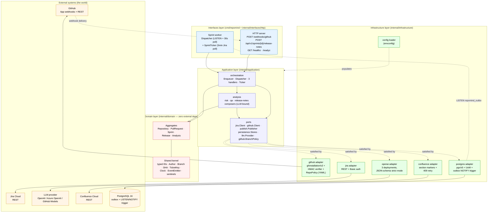
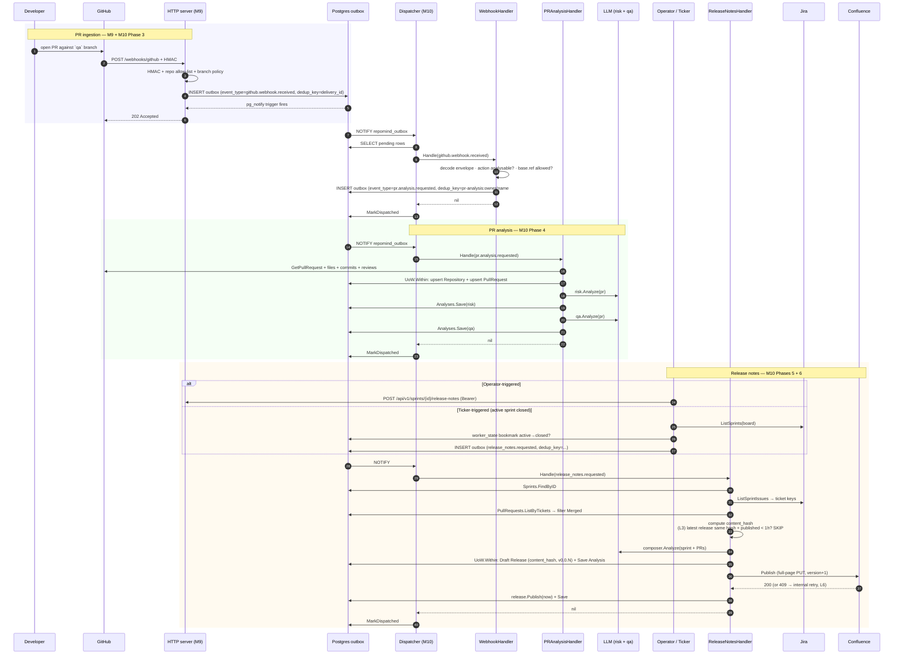
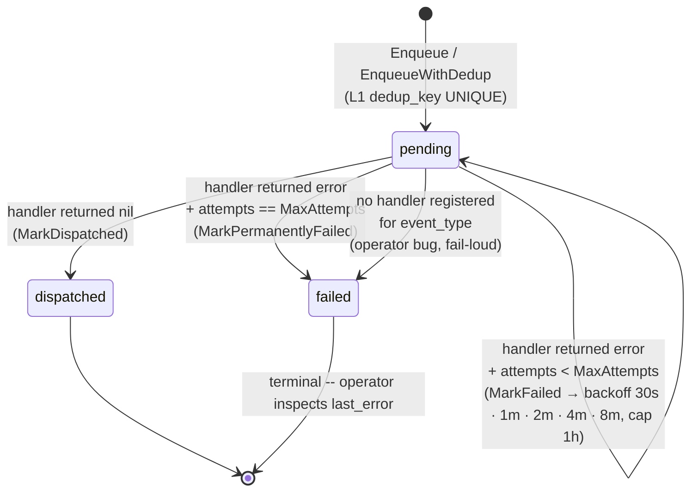

# RepoMind — visual reference

Three diagrams that explain how the system is shaped and how a webhook turns into a Confluence release note. **Open this file in any Markdown viewer that renders Mermaid** (GitHub web UI, VS Code with the *Markdown Preview Mermaid Support* extension, JetBrains, Obsidian, etc.).

For deeper detail see [docs/ARCHITECTURE.md](../ARCHITECTURE.md).

---

## 1. Architecture — Clean Architecture layers

Inward dependency rule: `interfaces → application → domain ← infrastructure`. The domain layer has zero imports outside itself.



**How to read it**
- Inward arrows = "depends on"; the domain has none pointing out.
- Dotted lines = "implements an interface defined by".
- All infrastructure adapters are swappable behind their port (the analysers don't know whether the LLM is GitHub Models or Azure OpenAI; the publisher could be Notion tomorrow).

---

## 2. End-to-end flow — from PR opened to Confluence updated

The two columns on the right are the M10 worker handlers; everything between `outbox: ...` arrows runs asynchronously via the dispatcher.



**Where the 6 duplicate-prevention layers fire** (see [ARCHITECTURE.md §5 Module 10](../ARCHITECTURE.md#module-10--sprint-worker-dispatcher--ticker)):

| Layer | Step in the diagram |
|---|---|
| L1 outbox dedup on insert | "INSERT outbox" steps — `UNIQUE(dedup_key)` collapses retries |
| L2 dispatcher idempotent mark | `MarkDispatched` is a no-op if already dispatched |
| L3 content-hash short-circuit | RNH `compute content_hash` step — skips LLM + Confluence |
| L4 transactional release insert | RNH `UoW.Within` — `UNIQUE(sprint_id, version)` enforced |
| L5 full-page PUT | RNH `Conf.Publish` — tickets can't appear twice in the page |
| L6 Confluence 409 retry | `Conf 200 or 409 retry` arrow |

---

## 3. Outbox event lifecycle (state machine)

Every `outbox` row is one of these states. M10's dispatcher drives the transitions.



**Visibility for operators:**

```sql
-- live dispatcher health
SELECT status, count(*) FROM outbox GROUP BY status;

-- in-flight events ready to attempt
SELECT id, event_type, attempts, dedup_key, next_attempt_at
FROM outbox
WHERE status = 'pending' AND next_attempt_at <= now()
ORDER BY next_attempt_at;

-- permanent failures with cause
SELECT id, event_type, attempts, last_error, created_at
FROM outbox
WHERE status = 'failed'
ORDER BY created_at DESC
LIMIT 20;
```

---

## How to keep these diagrams accurate

When a code change affects:

- **layering / new adapter** → update diagram 1.
- **handler registry / new event type / new outbound system** → update diagram 2.
- **outbox lifecycle / new outbox status** → update diagram 3.
- **6-layer dedup design** → update the table under diagram 2 + the matching §5 Module 10 entry in [ARCHITECTURE.md](../ARCHITECTURE.md).

Keep the diagrams in this file; do not fork a new diagrams file per module — the cognitive cost of "which diagram is canonical" outweighs the small benefit of separation.
